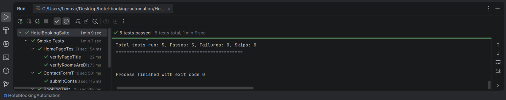

# Hotel Booking Automation


Selenium WebDriver UI test automation framework for a hotel booking website, built with Java 21, Maven and TestNG using the Page Object Model (POM) design pattern.

**Application under test:** [automationintesting.online](https://automationintesting.online), a practice hotel booking site.

---

## Features

- Page Object Model for clean, reusable and maintainable test code
- TestNG test suite configured through `testng.xml`
- Centralized browser setup and teardown in a base class
- Configurable base URL and browser through `config.properties` (Chrome and Edge)
- Explicit waits instead of hard-coded sleeps
- Automatic handling of the welcome popup before each test
- Click fallback using JavaScript when an element is intercepted
- Randomized booking dates to avoid clashes with existing reservations

## Tech Stack

| Tool | Version | Purpose |
|---|---|---|
| Java | 21 | Programming language |
| Selenium WebDriver | 4.25.0 | Browser automation |
| TestNG | 7.10.2 | Test framework and assertions |
| Maven | - | Build and dependency management |
| IntelliJ IDEA | - | IDE |

## Test Scenarios

| # | Test Class | Test Case | Description |
|---|---|---|---|
| 1 | HomePageTest | verifyPageTitle | Verifies the home page title |
| 2 | HomePageTest | verifyRoomsAreDisplayed | Verifies that rooms are listed on the home page |
| 3 | ContactFormTest | submitContactFormWithValidData | Fills and submits the contact form and checks the success message |
| 4 | BookingTest | verifyBookButtonOpensReservationPage | Checks that the Book button opens the reservation page |
| 5 | BookingTest | verifyRoomBookingWithValidDetails | Books a room with valid guest details and checks the confirmation |

## Project Structure

```
Hotel_Booking_Automation
├── pom.xml
├── testng.xml
├── docs/                          # Screenshots
└── src/main
    ├── java/com/Geeth
    │   ├── base/
    │   │   └── Base.java          # Browser setup and teardown
    │   ├── pages/
    │   │   ├── BasePage.java      # Common waits, click and type helpers
    │   │   ├── HomePage.java      # Home page and contact form
    │   │   └── BookingPage.java   # Reservation page
    │   ├── tests/
    │   │   ├── HomePageTest.java
    │   │   ├── ContactFormTest.java
    │   │   └── BookingTest.java
    │   └── utils/
    │       └── ConfigReader.java  # Reads config.properties
    └── resources/
        └── config.properties      # Base URL and browser settings
```

## Prerequisites

- JDK 21
- Google Chrome (or Microsoft Edge)
- IntelliJ IDEA (Community Edition is fine)
- Git

You do not need to download a browser driver. Selenium Manager (included in Selenium 4.6+) downloads the correct one automatically.

## Getting Started

**1. Clone the repository**

```bash
git clone https://github.com/geeth0430/Hotel_Booking_Automation.git
```

**2. Open the project in IntelliJ IDEA**

Open the cloned folder and wait for Maven to import the dependencies. If the imports are red, click the Maven **Reload** icon.

**3. Check the configuration**

`src/main/resources/config.properties`:

```properties
baseUrl=https://automationintesting.online
browser=chrome
```

Set `browser=edge` to run on Microsoft Edge.

## Running the Tests

In IntelliJ, right-click `testng.xml` and choose **Run**. Chrome opens and the five tests run one after another. The results appear in the Run window.

## Test Results

All 5 test cases pass.

| Total | Passed | Failed | Skipped |
|---|---|---|---|
| 5 | 5 | 0 | 0 |



## Design Notes

- **Base class:** `Base` opens the browser, loads the site, closes the welcome popup, and quits the driver after every test.
- **Page classes:** each page keeps its locators and actions in one class, so tests read like plain steps and a UI change only needs one fix.
- **Helpers:** `BasePage` wraps waiting, scrolling, clicking and typing in one place.
- **Locators:** CSS selectors and XPath, with fallbacks where the site's markup can vary.

## Future Improvements

- Screenshot capture on test failure
- Extent Reports for HTML reporting
- Data-driven tests with TestNG `@DataProvider`
- Parallel execution
- CI pipeline with GitHub Actions

## Author

**Geeth**
GitHub: [@geeth0430](https://github.com/geeth0430)
